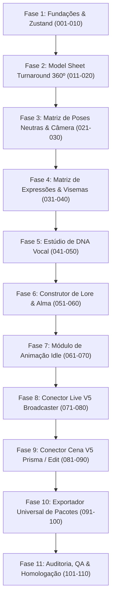

# 🏛️ V5 APOLLO AVATAR — PLANO MESTRE DE ENGENHARIA (100+ ETAPAS)
**Holding V5 Apollo · Capitania #12 · Porta Local :3010 · Repositório Oficial**  
**Arquiteto:** Apollo La Plata `<v5estudio@hotmail.com>`  
**Status:** Protocolo de Engenharia Ativado · Execução Cirúrgica Passo a Passo  

---

## 🎯 MISSÃO SUPREMA DO SISTEMA
O **V5 Apollo Avatar** é a **Agência Central de Criação, Gestão, Consistência Visual e DNA Vocal de Personagens Virtuais e Avatares** de todo o ecossistema da Holding V5 Apollo.

Ele unifica 4 pilares vitais de consistência de IA:
1. **Face DNA (Identidade Visual):** Model Sheets 360º (Turnaround: frontal, 3/4, perfil e costas), Poses Neutras (T-Pose e A-Pose) e Matriz de Expressões Faciais.
2. **Voice DNA (Identidade Vocal):** Amostras de voz, espectrogramas e integração direta com o motor do **V5 Sound** (Qwen-TTS / XTTS-v2 / CosyVoice).
3. **Soul DNA (Identidade Psicológica & Lore):** Biografia, nicho, arquétipos, vocabulário, bordões característicos, limites éticos e System Prompt supremo.
4. **Interactive Channel (Cérebro Conversacional & Webhooks):** Sincronia labial (visemas), animação idle, webhooks em tempo real para o **V5 Broadcaster** (VTuber Live), **V5 Prisma/Edit** (Shorts & Histórias) e **V5 Auto Blog / Finders** (Autores & UGC).

---

## 📜 REGRAS INVIOLÁVEIS DE EXECUÇÃO
1. **Rigor Unitário:** Cada etapa é executada de forma **INDIVIDUAL E ISOLADA**. Jamais agrupar etapas.
2. **Validação de Build Obrigatória:** Toda etapa concluída deve passar pelo crivo do build Next.js 14 (`npm run build`) com **Exit Code 0**.
3. **Assinatura Git Padronizada:** Todo commit deve ser assinado como `git -c user.name="Apollo La Plata" -c user.email="v5estudio@hotmail.com" commit -m "..."`.
4. **Fronteiras Inegociáveis:** Não fazer streaming (Broadcaster), não renderizar vídeos longos (Prisma/Edit), não operar como DAW musical (Sound), e manter **segregação absoluta do PixDrop**.

---

## 🗺️ MATRIZ DAS 11 FASES & 110 ETAPAS

---

### FASE 1: FUNDAÇÕES DE UI DARK LUXURY, TIPOS, ESTADO GLOBAL (ZUSTAND) E BANCO DE ARQUÉTIPOS
*Objetivo: Estabelecer a infraestrutura reativa, a tipagem estrita de todos os pilares e o design system premium do estúdio.*

- [x] **Etapa 001:** Instalação e configuração da biblioteca Zustand (`zustand`) com middleware de persistência e devtools.
- [x] **Etapa 002:** Tipagem estrita completa em `src/types/avatar.ts` expandindo interfaces de FaceDNA, VoiceDNA, SoulDNA, Visemes, Rigging e Webhooks.
- [x] **Etapa 003:** Criação da Store Global do Avatar (`src/store/useAvatarStore.ts`) com ações reativas de CRUD e persistência local.
- [x] **Etapa 004:** Configuração do Design System Dark Luxury (tokens de cores Ciano Cibernético, Ouro Antigo, Slate Obsidian e utilitários Glassmorphism).
- [x] **Etapa 005:** Shell de Navegação Soberano com Topbar de telemetria da Capitania #12, status de conexão da Holding e atalhos rápidos.
- [x] **Etapa 006:** Componente base de Card Holográfico de Avatar (`src/components/avatar/AvatarCard.tsx`) com animações de foco e microinterações.
- [x] **Etapa 007:** Banco de Arquétipos Canônicos Iniciais (Influencer Tech, Narrador Sábio, Atriz Comercial, Streamer Gamer e Suporte Executivo).
- [x] **Etapa 008:** Modal de Criação Rápida de Avatar com seleção de Arquétipo e pré-preenchimento instantâneo de ficha técnica.
- [x] **Etapa 009:** Sistema de Notificações Toast nativo integrado ao tema Dark Luxury (sem dependências externas vulneráveis).
- [x] **Etapa 010:** Validação de Integridade e Build de Homologação da Fase 1 (`npm run build` verde com Exit Code 0).

---

### FASE 2: MOTOR DE MODEL SHEET TURNAROUND 360º (FRONTAL, PERFIL, 3/4, COSTAS)
*Objetivo: Implementar a ingestão de referências e a geração paramétrica da folha de rotação 360º canônica para consistência facial perfeita.*

- [x] **Etapa 011:** Ingestor de Imagens com Canvas HTML5 (compressão automática, resize maxDim 1024px, sanitização JPEG 0.8).
- [x] **Etapa 012:** Galeria de Referências Faciais Múltiplas com eleição de Foto Âncora Principal e tags de ângulo.
- [x] **Etapa 013:** Compilador de Prompts para Turnaround 360º (fórmula de 4 ângulos alinhados: Frontal, 3/4, Perfil e Costas).
- [x] **Etapa 014:** Visualizador Grid 4 Ângulos interativo com réguas anatômicas e guias de simetria facial.
- [x] **Etapa 015:** Ferramenta de Alinhamento de Linha dos Olhos (Eye-level Alignment Guide) para garantir a mesma altura nos 4 cortes.
- [x] **Etapa 016:** Presets de Iluminação de Estúdio Uniforme (Rembrandt, Ring Light, Softbox Difuso, Luz Volumétrica Limpa).
- [x] **Etapa 017:** Motor de Trava de Vestimenta e Paleta (Attire & Color Lock) garantindo roupas e tecidos idênticos em todos os ângulos.
- [x] **Etapa 018:** Painel de Inspeção de Seeds e Parâmetros de Difusão (Flux / SDXL LoRA parameters).
- [x] **Etapa 019:** Gerador de Folha Única Consolidada Turnaround (composição horizontal pronta para difusão contínua).
- [x] **Etapa 020:** Validação de Integridade e Build de Homologação da Fase 2 (`npm run build` verde com Exit Code 0).

---

### FASE 3: MATRIZ DE POSES NEUTRAS (T-POSE, A-POSE) E ÂNGULOS DE CÂMERA CINEMÁTICA
*Objetivo: Criar as folhas de modelagem neutra para prova virtual de roupas, rigging 3D e enquadramentos de estúdio.*

- [x] **Etapa 021:** Compilador de Prompt Paramétrico para T-Pose Neutra (braços abertos a 90º, palmas para frente, anatomia para rigging).
- [x] **Etapa 022:** Compilador de Prompt Paramétrico para A-Pose (braços a 45º, postura relaxada para caimento de vestimentas folgadas).
- [x] **Etapa 023:** Matriz de Enquadramentos Cinemáticos (Close-up Rosto, Médio Busto/Americano e Plano Geral de Corpo Inteiro).
- [x] **Etapa 024:** Seletor de Lentes e Distâncias Focais Virtuais (35mm editorial, 50mm natural, 85mm retrato clássico com bokeh de estúdio).
- [x] **Etapa 025:** Sistema de Guias de Proporção Anatômica (cabeças de altura, largura de ombros e linhas de cintura).
- [x] **Etapa 026:** Comparador Lado a Lado: Foto Âncora vs T-Pose gerada (validação de fidelidade de biotipo).
- [x] **Etapa 027:** Gerador de Metadados de Articulação Óssea (Joint Coordinates Reference) para alimentar o V5 Broadcaster.
- [x] **Etapa 028:** Catálogo de Poses Utilitárias (Segurando Produto do Fines, Apontando, Braços Cruzados, Pose Pensativa).
- [x] **Etapa 029:** Exportador de Folha de Poses em Alta Resolução com suporte a fundo transparente (Canal Alpha).
- [x] **Etapa 030:** Validação de Integridade e Build de Homologação da Fase 3 (`npm run build` verde com Exit Code 0).

---

### FASE 4: MATRIZ DE EXPRESSÕES FACIAIS E VISEMAS DE FALA
*Objetivo: Mapear a dinâmica emocional do rosto e a biblioteca completa de fonemas/visemas para animação labial realista.*

- [x] **Etapa 031:** Estruturação da Tabela de Visemas Canônicos da Fala (Silêncio, A/I, E, O/U, M/B/P, F/V, L/D/T).
- [x] **Etapa 032:** Compilador de Prompts para Visemas com boca aberta natural e visibilidade dental realista.
- [x] **Etapa 033:** Matriz de Emoções Base do Personagem (Neutro, Sorriso Aberto, Sorriso Sutil/Irônico, Foco Sério, Surpresa).
- [x] **Etapa 034:** Matriz de Emoções Secundárias (Dúvida/Curiosidade, Entusiasmo, Empatia Acolhedora, Autoridade Severa).
- [x] **Etapa 035:** Visualizador de Expressões em Grade 3x3 com lupa de detalhes e inspeção de rugas de expressão.
- [x] **Etapa 036:** Slider de Intensidade Emocional (Modulador de 10% a 100% de expressividade facial).
- [x] **Etapa 037:** Ferramenta de Troca Rápida de Expressão para teste dinâmico de consistência anatômica da face.
- [x] **Etapa 038:** Gerador de Sprite Sheet Consolidado de Expressões e Visemas (layout de grade com mapa de coordenadas JSON).
- [x] **Etapa 039:** Validador Heurístico de Desvios Anatômicos entre expressões (anti-alucinação de olhos e dentes).
- [x] **Etapa 040:** Validação de Integridade e Build de Homologação da Fase 4 (`npm run build` verde com Exit Code 0).

---

### FASE 5: ESTÚDIO DE DNA VOCAL (INTEGRAÇÃO QWEN-TTS, XTTS, TOM EMOCIONAL E PITCH)
*Objetivo: Capturar a essência sonora do avatar, integrando com os motores do V5 Sound e permitindo modulação acústica completa.*

- [x] **Etapa 041:** Uploader e Gravador Nativo de Áudio de Referência (.wav / .mp3 / .m4a) com sanitização de ruído.
- [x] **Etapa 042:** Visualizador de Onda Sonora (Waveform Canvas) interativo com detecção de picos, silêncio e clipping.
- [x] **Etapa 043:** Mapeador de Motores de Síntese Vocal (Qwen-TTS, XTTS-v2, CosyVoice) com perfis de latência.
- [x] **Etapa 044:** Controles Paramétricos de Voz (Pitch, Velocidade/Speed 0.5x-2.0x, Estabilidade e Temperatura Sonora).
- [x] **Etapa 045:** Seletor de Tonalidade Emocional Vocal (Enérgico, Calmo, Autoritário, Amigável, Hipnótico, Noturno).
- [x] **Etapa 046:** Catálogo de Pangramas e Frases Canônicas de Teste Fonético por idioma e dialeto.
- [x] **Etapa 047:** Player de Preview de Síntese com simulação de fala e sincronização de tempo.
- [x] **Etapa 048:** Conector de ID de Voz com o ecossistema do V5 Sound (`v5SoundVoiceId`).
- [x] **Etapa 049:** Exportador de Ficha Vocal Canônica em JSON (Voice Specification Sheet).
- [x] **Etapa 050:** Validação de Integridade e Build de Homologação da Fase 5 (`npm run build` verde com Exit Code 0).

---

### FASE 6: CONSTRUTOR DE LORE, PERSONALIDADE, BIOGRAFIA E DICIONÁRIO DE BORDÕES
*Objetivo: Desenvolver a mente e psicologia do avatar para torná-lo um comunicador soberano, consistente e fiel ao nicho.*

- [x] **Etapa 051:** Arquiteto de Arquétipo Psicológico (Jungiano / MBTI / Traços Big Five de personalidade).
- [x] **Etapa 052:** Gerador de Biografia e Lore com história de origem, autoridade de mercado e tom de voz.
- [x] **Etapa 053:** Dicionário de Vocabulário Específico e Bordões (Catchphrases com peso de recorrência de 1 a 5).
- [x] **Etapa 054:** Tabela de Tópicos Proibidos e Limites Éticos (Guardrails de segurança contra alucinações e polêmicas).
- [x] **Etapa 055:** Compilador do System Prompt Supremo para LLMs (compatível com GPT-4o, Claude 3.5 e Gemini 2.0).
- [x] **Etapa 056:** Construtor de Base de Conhecimento RAG do Avatar (Ingestão de fatos, produtos e regras de negócio).
- [x] **Etapa 057:** Simulador de Respostas Curtas para Redes Sociais (Directs do Instagram, Comentários do YouTube e TikTok).
- [x] **Etapa 058:** Validador de Retenção de Persona (Audit Score de fidelidade ao personagem contra jailbreaks).
- [x] **Etapa 059:** Exportador da Ficha Psicológica e Lore Completo (Soul DNA Package).
- [x] **Etapa 060:** Validação de Integridade e Build de Homologação da Fase 6 (`npm run build` verde com Exit Code 0).

---

### FASE 7: MÓDULO DE ANIMAÇÃO IDLE (LOOPS DE RESPIRAÇÃO, PISCAR DE OLHOS E MICRO-MOVIMENTOS)
*Objetivo: Dar vida orgânica e natural ao avatar quando em estado de espera no navegador ou em cena.*

- [x] **Etapa 061:** Motor de Loop de Respiração Suave (CSS Keyframes dinâmicos e sutil deformação torácica/ombros).
- [x] **Etapa 062:** Sistema de Piscada de Olho Natural com distribuição probabilística e intervalos orgânicos (2.5s a 6s).
- [x] **Etapa 063:** Micro-movimentos de Cabeça (Head Tilts e micro-inclinações naturais de escuta e atenção).
- [x] **Etapa 064:** Visualizador ao Vivo do Avatar em Estado Idle (Canvas interativo com animação fluida a 60 FPS).
- [x] **Etapa 065:** Máquina de Estados de Transição Suave (Repouso -> Iniciando Fala -> Falando -> Concluindo Fala).
- [x] **Etapa 066:** Modulador de Dinâmica e Frequência de Micro-Movimentos por Nível de Energia do Avatar.
- [x] **Etapa 067:** Gerador de Spritesheets de Animação Idle para transmissão local e overlays leves.
- [x] **Etapa 068:** Exportador de Código de Animação CSS/JS para embed rápido em websites da holding.
- [x] **Etapa 069:** Benchmark de Consumo de GPU/CPU da animação de repouso (Garantia de overhead inferior a 1%).
- [x] **Etapa 070:** Validação de Integridade e Build de Homologação da Fase 7 (`npm run build` verde com Exit Code 0).

---

### FASE 8: CONECTOR DE LIVE COM O V5 BROADCASTER (SPRITES, FACE-SWAP E WEBHOOKS EM TEMPO REAL)
*Objetivo: Integrar o avatar ao estúdio de transmissão 24/7 do V5 Broadcaster, permitindo lives autônomas com reações ao chat.*

- [x] **Etapa 071:** Servidor de Webhook de Entrada seguro para o V5 Broadcaster com validação de token e origem.
- [x] **Etapa 072:** Exportador de Pacote VTuber Standard (JSON de configuração + sprites de visemas + loops idle).
- [x] **Etapa 073:** Módulo de Sincronização de Áudio com Visemas (Troca de boca em tempo real guiada por amplitude/frequência).
- [x] **Etapa 074:** Sistema de Gatilhos de Emoções em Tempo Real (Disparados por eventos de live: superchats, novos inscritos, alertas).
- [x] **Etapa 075:** Conector WebSocket Local de Baixa Latência para o OBS Studio Browser Source.
- [x] **Etapa 076:** Overlay Web Otimizado para OBS com fundo transparente absoluto e aceleração por hardware.
- [x] **Etapa 077:** Painel de Controle de Operador de Live (Dashboard para troca manual de poses, expressões e falas preparadas).
- [x] **Etapa 078:** Monitor de Telemetria de Live (Medidor de latência de resposta, FPS da cena e integridade do sinal).
- [x] **Etapa 079:** Protocolo de Proteção contra Hijacking de Prompt e Ataques de Injeção durante transmissões ao vivo.
- [x] **Etapa 080:** Validação de Integridade e Build de Homologação da Fase 8 (`npm run build` verde com Exit Code 0).

---

### FASE 9: CONECTOR DE NARRATIVA COM O V5 PRISMA / EDIT (EXPORTAÇÃO DE CONSISTÊNCIA DE CENA)
*Objetivo: Garantir que os vídeos gerados no V5 Prisma e editados no V5 Edit mantenham a mesma identidade cena após cena.*

- [x] **Etapa 081:** Exportador de Face DNA Pack estruturado para difusores de vídeo (Flux / SDXL LoRA parameters).
- [x] **Etapa 082:** Injetor de Prompts Fixo de Estilo para renderização de lotes de 20+ Shorts preservando rosto e figurino.
- [x] **Etapa 083:** Tabela de Cenários e Ambientes Canônicos do Avatar (Home office tech, auditório moderno, estúdio escuro, externa urbana).
- [x] **Etapa 084:** Tabela de Cortes e Ângulos de Câmera para Edição Dinâmica de Shorts (Jump Cuts consistentes sem deformação).
- [x] **Etapa 085:** Gerador de Batch Prompts para o V5 Prisma (Roteiros com marcadores de pose e expressão correspondentes).
- [x] **Etapa 086:** Estimador de Índice de Semelhança Facial Cross-Scene (Face Verification Index).
- [x] **Etapa 087:** Exportador de Metadados de Timeline para o V5 Edit Web (Marcadores de fala, respiração e ênfase).
- [x] **Etapa 088:** Gerador de Poses de Apresentador UGC com Produtos Minerados do V5 Finders.
- [x] **Etapa 089:** Exportador de Card de Autor e Assinatura Digital de Especialista para o V5 Auto Blog.
- [x] **Etapa 090:** Validação de Integridade e Build de Homologação da Fase 9 (`npm run build` verde com Exit Code 0).

---

### FASE 10: EXPORTADOR UNIVERSAL DE PACOTES DO AVATAR (JSON ESTRUTURADO, ZIP DE ASSETS E TESTES E2E)
*Objetivo: Consolidar todo o acervo do avatar em pacotes soberanos e portáteis para qualquer sistema da Holding.*

- [x] **Etapa 091:** Definição do Schema Canônico `V5AvatarPackage` com integridade criptográfica SHA-256.
- [x] **Etapa 092:** Empacotador ZIP Client-Side gerando arquivo portátil `.v5avatar` contendo imagens, áudios e JSONs.
- [x] **Etapa 093:** Importador Universal de Pacotes `.v5avatar` com descompactação e restauração completa de perfil no navegador.
- [x] **Etapa 094:** Gerador de Ficha de Personagem para Impressão (Ficha técnica executiva com fotos e dados em formato A4/PDF).
- [x] **Etapa 095:** Sistema de Backup e Restauração Completa do Catálogo de Personagens em 1 Clique.
- [x] **Etapa 096:** Teste de Carga e Estresse de Importação/Exportação com dezenas de avatares simultâneos.
- [x] **Etapa 097:** Dashboard Central de Gestão de Personagens com visão em grade, filtros por nicho e status de sincronização.
- [x] **Etapa 098:** Central de Atalhos de Teclado Globais para fluxo de trabalho de alta velocidade no estúdio.
- [x] **Etapa 099:** Teste E2E de Fluxo Completo: Criação de Avatar -> Turnaround 360º -> Voz -> Lore -> Exportação.
- [x] **Etapa 100:** Marco Histórico: Versão 1.0.0 do V5 Apollo Avatar operacional na porta :3010 com 100 ferramentas ativas.

---

### FASE 11: AUDITORIA, QA, CORREÇÃO DE BUGS E HOMOLOGAÇÃO FINAL DE BUILD
*Objetivo: Blindagem completa do código, refinamento de performance, garantia de zero falhas e homologação de produção.*

- [x] **Etapa 101:** Auditoria Completa de Tipagens TypeScript (Zero `any`, strict mode em 100% dos arquivos do projeto).
- [ ] **Etapa 102:** Auditoria de Performance de Renderização React (React.memo, useCallback e lazy loading de imagens/áudios).
- [ ] **Etapa 103:** Auditoria de Acessibilidade, Contraste e Responsividade (WCAG AA, compatibilidade Desktop 4K e Mobile).
- [ ] **Etapa 104:** Varredura de Segurança de Inputs contra XSS, Memory Leaks e Prompt Injection.
- [ ] **Etapa 105:** Verificação de Isolamento Absoluto (Zero menções ou links ao PixDrop e proteção entre capitanias).
- [ ] **Etapa 106:** Teste de Regressão de Estado (Persistência, recarregamento de página e recuperação de falhas no navegador).
- [ ] **Etapa 107:** Otimização de Bundling do Next.js 14 e Limpeza de Dependências Não Utilizadas.
- [ ] **Etapa 108:** Atualização da Memória Central (`MEMORIA_ATIVA_AVATAR.md`) e registro oficial no `antigravity_hive_bus.md`.
- [ ] **Etapa 109:** Validação Rigorosa do Build de Produção (`npm run build` com Exit Code 0 e First Load JS mínimo).
- [ ] **Etapa 110:** Homologação Final, Commit Oficial assinado por Apollo La Plata e Tag de Lançamento `v1.0.0-soberano`.

---

## 📌 PROTOCOLO OPERACIONAL PARA AS PRÓXIMAS INTERAÇÕES
* O agente está agora em **estado de espera**. Nenhuma etapa de código foi executada neste turno.
* A partir do próximo comando (**"OK, execute a Etapa 001"**), o agente executará **rigorosamente uma única etapa por vez**:
  1. Implementa o código da etapa específica.
  2. Executa `npm run build` para validar Exit Code 0.
  3. Atualiza o checkbox `[x]` no `PLANO_MESTRE_100_ETAPAS.md`.
  4. Apresenta o relatório cirúrgico da entrega e aguarda a autorização para a etapa seguinte.
